  

### Projects

  
  

### Tech stack

| | |
|---|---|
| **Languages** |    |
| **Rust** |   |
| **Roblox** |        |
| **Tools** |     |

### Currently

- Building **couby** to help coding agents find their way
- Making Roblox UI that scales cleanly on every screen

### Contact

  
  

