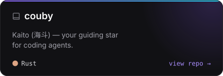
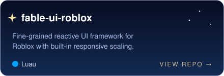

  

### ✦ Pinned constellations

  
  

### ✦ Tech stack

| | |
|---|---|
| **Languages** |    |
| **Rust** |   |
| **Roblox** |        |
| **Tools** |     |

### ✦ Currently

- Building **couby** to help coding agents find their way
- Making Roblox UI that scales cleanly on every screen

### ✦ Contact

  
  

✦ · follow the stars · ✦

